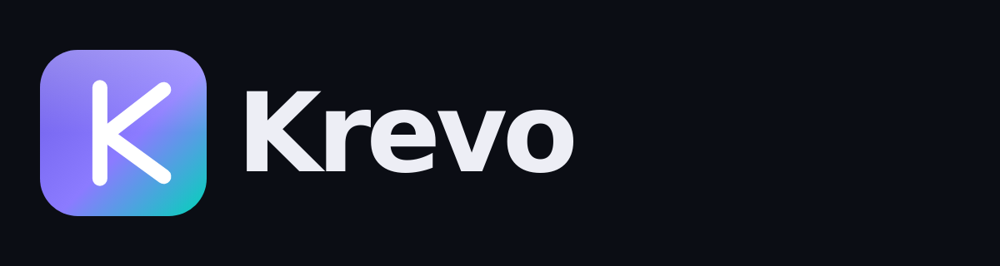
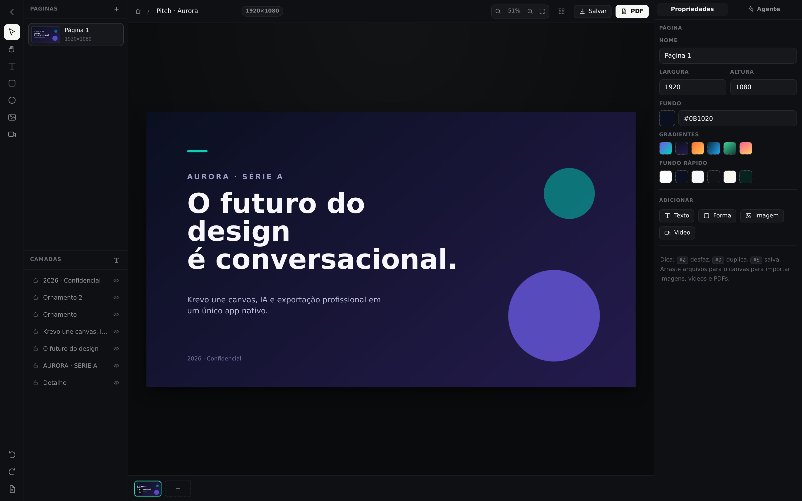

<div align="center">



### Crie tudo. Em um só lugar.

**O estúdio de design nativo em Rust** — PDF, apresentações, imagens, vídeo e mais,
com um agente de IA ao lado e **a sua própria chave de API**.

[](https://github.com/Pedro21062014/krevo/actions/workflows/build.yml)
[](https://github.com/Pedro21062014/krevo/actions/workflows/pages.yml)
[](LICENSE)
[](https://www.rust-lang.org)

[Site](https://pedro21062014.github.io/krevo/) · [Download](https://github.com/Pedro21062014/krevo/releases/latest) · [Como contribuir](CONTRIBUTING.md)

</div>

---

## Índice

- [O que é o Krevo](#o-que-é-o-krevo)
- [Aplicativo desktop](#aplicativo-desktop)
- [Agente de IA (traga a sua chave)](#agente-de-ia-traga-a-sua-chave)
- [PDF vetorial em Rust](#pdf-vetorial-em-rust)
- [Download](#download)
- [Rodando do código-fonte](#rodando-do-código-fonte)
- [Arquitetura](#arquitetura)
- [Chaves de API](#chaves-de-api)
- [Formatos e templates](#formatos-e-templates)
- [Atalhos](#atalhos)
- [Testes](#testes)
- [Site de divulgação](#site-de-divulgação)
- [Limitações conhecidas](#limitações-conhecidas)
- [Licença](#licença)

---

## O que é o Krevo

Krevo é um editor de design **de mesa**, escrito em **Rust** (núcleo + backend
Tauri) e **TypeScript** (interface), que junta no mesmo app:

| Você quer… | O Krevo faz |
|---|---|
| editar/gerar **PDF** | importa PDFs (até 30 páginas) e exporta PDF **vetorial** |
| montar **apresentações** | páginas em 16:9, A4, story, banner… com miniaturas instantâneas |
| compor **imagens** | arrastar e soltar, corte cover/contain, máscaras, sombras, ícones |
| trabalhar com **vídeo** | solta o vídeo no canvas, define capa e exporta o frame |
| ter **elementos prontos** | 10 templates, 25 ícones, 10 gradientes, 8 paletas |
| buscar **fotos** | Unsplash com a sua chave + acervo local offline |
| criar com **IA** | agente que desenha no canvas com a **sua** API (9 provedores) |
| abrir rápido | app nativo Tauri: abre em menos de 1 s, ~8 MB, sem Electron |

Tudo local. Sem cadastro, sem assinatura, sem telemetria.

---

## Aplicativo desktop

### Tela inicial

- Saudação por horário + campo de **briefing** que já vira design.
- **Criar novo** em branco por formato (10 presets em px reais).
- **Skeleton loader** shimmering enquanto os projetos recentes carregam.
- **Projetos recentes** com miniatura real da primeira página, contagem de
  páginas e tempo relativo.
- Abas: **Início · Templates · Elementos · Fotos & Unsplash · Agente de IA · Ajustes**.

### Editor

- Canvas com zoom (⌘+scroll), pan (espaço/scroll), ajuste automático à tela.
- Seleção múltipla (Shift), arraste, 8 alças de redimensionamento, rotação,
  proporção travada com Shift, snap magnético com guias rosa.
- Painel de **camadas** (ocultar/bloquear), **páginas** (duplicar/excluir/trocar),
  **inspetor** completo (x, y, w, h, rotação, opacidade, texto, mídia, formas).
- Histórico de 80 estados (⌘Z / ⇧⌘Z).
- Importação por arraste: imagens, vídeos, `.krevo` e **PDFs**.



---

## Agente de IA (traga a sua chave)

O agente **não escreve código**: ele devolve um **plano de design em JSON**
(uma lista de elementos posicionados) e o Krevo aplica no canvas — você continua
editando tudo à mão.

```
briefing  →  system prompt (grid, margem, paleta da marca)  →  provedor
          →  plano JSON  →  elementos no canvas  →  você ajusta  →  exporta
```

Provedores suportados de fábrica:

| Provedor | Id | Modelo padrão | Precisa de chave |
|---|---|---|---|
| OpenAI | `openai` | `gpt-4o-mini` | sim |
| Anthropic | `anthropic` | `claude-sonnet-4-20250514` | sim |
| Google Gemini | `gemini` | `gemini-2.0-flash` | sim |
| OpenRouter | `openrouter` | `openai/gpt-4o-mini` | sim |
| Groq | `groq` | `llama-3.3-70b-versatile` | sim |
| DeepSeek | `deepseek` | `deepseek-chat` | sim |
| Mistral | `mistral` | `mistral-large-latest` | sim |
| **Ollama (local)** | `ollama` | `llama3.1` | não |
| Endpoint compatível | `custom` | — | opcional |

- A chave fica no armazenamento local do app e é usada pelo processo Rust para
  falar **direto** com o provedor. Não existe servidor intermediário do Krevo.
- **Modo demo:** sem chave, um gerador local determinístico monta um layout
  decente (paleta escolhida por palavra-chave) para você testar tudo offline.
- Ajuste fino do prompt em [`crates/krevo-core/src/agent.rs`](crates/krevo-core/src/agent.rs)
  (`system_prompt`).

---

## PDF vetorial em Rust

`krevo_core::pdf` escreve os operadores do PDF diretamente — nenhum navegador
headless é iniciado:

```rust
use krevo_core::{pdf, Project};

let projeto = Project::demo();          // ou carregado de um .krevo
let bytes = pdf::render_pdf(&projeto)?; // Vec<u8> com o PDF completo
std::fs::write("deck.pdf", bytes)?;
```

O que já é suportado:

- texto **selecionável** com quebra automática de linha, alinhamento e kerning básico;
- retângulos com cantos arredondados, elipses, linhas e contornos;
- sombras aproximadas por camadas translúcidas;
- imagens embutidas (PNG/JPEG) com `cover`, `contain` e `fill`;
- gradientes lineares (aproximados por 96 bandas);
- múltiplas páginas, uma por frame do projeto.

Gere um exemplo real:

```bash
cargo run -p krevo-core --example export_demo -- docs/krevo-demo.pdf
# → PDF gerado: docs/krevo-demo.pdf (19 KB, 2 páginas)
```

---

## Download

Os instaladores são gerados automaticamente pelo GitHub Actions a cada push em
`main` (artefatos) e a cada tag `v*` (Release):

| Plataforma | Arquivos | Como instalar |
|---|---|---|
| **Windows 10/11 (x64)** | `Krevo_0.1.0_x64-setup.exe`, `Krevo_0.1.0_x64_en-US.msi` | execute o instalador (por usuário) |
| **macOS 10.15+** | `Krevo_0.1.0_aarch64.dmg` (Apple Silicon), `Krevo_0.1.0_x64.dmg` (Intel) | abra o `.dmg` e arraste para Aplicativos |
| **Linux** | `Krevo_0.1.0_amd64.deb`, `Krevo_0.1.0_amd64.AppImage` | `sudo dpkg -i` ou `chmod +x` no AppImage |

Os builds **não são assinados**. No macOS use botão direito → *Abrir*; no Windows
o SmartScreen pode pedir *Mais informações → Executar assim mesmo*.

Baixe em **[Releases](https://github.com/Pedro21062014/krevo/releases/latest)** ou
veja todos os artefatos em [Actions](https://github.com/Pedro21062014/krevo/actions/workflows/build.yml).

---

## Rodando do código-fonte

### Requisitos

- **Rust** estável 1.77+ (`rustup`)
- **Node.js** 20+ e npm
- Dependências de sistema (Linux):
  ```bash
  sudo apt install libwebkit2gtk-4.1-dev libgtk-3-dev libayatana-appindicator3-dev \
                   librsvg2-dev patchelf libssl-dev libsoup-3.0-dev build-essential
  ```

### Desenvolvimento

```bash
# 1. dependências da interface
cd apps/desktop && npm install

# 2. app desktop com hot reload
npm run tauri:dev

# ou só a interface no navegador (modo web, sem Rust)
npm run dev     # http://localhost:5173
```

> No navegador, os comandos Rust caem em implementações TypeScript equivalentes
> (busca local de fotos, gerador demo, exportação via impressão). A experiência
> completa — PDF vetorial, salvar arquivos, Unsplash — roda no app desktop.

### Build de release

```bash
cd apps/desktop
npm run tauri:build                 # todos os bundles do seu sistema
npm run tauri:build -- --bundles deb # só o .deb (exemplo)
```

Saída em `target/release/bundle/{deb,appimage,dmg,nsis,msi}/`.

---

## Arquitetura

```
krevo/
├── Cargo.toml                     workspace
├── crates/krevo-core/             NÚCLEO (Rust puro, sem UI)
│   ├── model.rs                   Project · Page · Element (JSON versionado)
│   ├── ai.rs                      9 provedores, dialetos OpenAI/Anthropic/Gemini
│   ├── agent.rs                   system prompt + parsing do plano + modo demo
│   ├── pdf.rs                     gerador de PDF vetorial
│   ├── unsplash.rs                cliente Unsplash + acervo local
│   ├── theme.rs                   paletas curadas por palavra-chave
│   └── error.rs
├── apps/desktop/
│   ├── src/                       INTERFACE (TypeScript + Vite, zero framework)
│   │   ├── main.ts  store.ts  bridge.ts  types.ts  util.ts  assets.ts
│   │   └── ui/  home.ts · editor.ts · agent.ts · render.ts · icons.ts
│   └── src-tauri/                 APP (Tauri 2) — comandos Rust → JS
│       ├── src/lib.rs             13 comandos (IA, PDF, arquivos, Unsplash…)
│       ├── tauri.conf.json        janela, bundles, ícones
│       └── capabilities/          permissões mínimas
├── site/                          site de divulgação (GitHub Pages)
├── brand/                         marca em SVG/PNG
└── .github/workflows/             build (5 plataformas) + pages
```

**Princípio:** a interface é "burra", o núcleo é Rust. Nada de lógica de negócio
no front. O mesmo crate `krevo-core` é usado pelos testes, pelo app e pelo
exemplo de CLI.

### Comandos Tauri expostos

| Comando | O que faz |
|---|---|
| `app_info` | versão, plataforma, provedores disponíveis |
| `ai_chat` | chama o provedor escolhido com a chave do usuário |
| `design_system_prompt` | monta o prompt do agente para o tamanho da página |
| `design_demo_plan` | gera layout local (offline) |
| `design_parse_plan` | normaliza o JSON devolvido pelo modelo |
| `unsplash_search` / `stock_local` | fotos do Unsplash ou acervo local |
| `export_pdf` | PDF vetorial pelo motor Rust |
| `save_project` / `load_project` | arquivo `.krevo` |
| `save_binary` / `read_media_base64` | mídia local ↔ projeto |
| `project_stats` | contagens de páginas/elementos |

---

## Chaves de API

### IA (opcional, mas recomendado)

| Provedor | Onde criar |
|---|---|
| OpenAI | <https://platform.openai.com/api-keys> |
| Anthropic | <https://console.anthropic.com/settings/keys> |
| Google Gemini | <https://aistudio.google.com/app/apikey> |
| OpenRouter | <https://openrouter.ai/keys> |
| Groq | <https://console.groq.com/keys> |
| DeepSeek | <https://platform.deepseek.com/api_keys> |
| Mistral | <https://console.mistral.ai/api-keys> |
| Ollama | `ollama serve` — sem chave, roda na sua máquina |

Cole em **Ajustes → Agente de IA** e clique em **Testar conexão**.

### Unsplash (opcional)

Crie um app grátis em <https://unsplash.com/developers> e copie a **Access Key**
para **Ajustes → Chave do Unsplash**. Sem chave, o Krevo usa o acervo local
gerado proceduralmente (funciona offline e imprime nítido).

---

## Formatos e templates

**Formatos:** Apresentação 1920×1080 · Slide 1280×720 · A4 794×1123 · A4 paisagem ·
Post 1080×1080 · Story 1080×1920 · Retrato 1080×1350 · Banner 1200×628 ·
Vídeo Full HD · Capa 1600×900.

**Templates:** Pitch Aurora · Slide Agenda · Post Lançamento · Story Promoção ·
Relatório A4 · Currículo minimal · Banner LinkedIn · Certificado · Card de preço ·
Em branco.

---

## Atalhos

| Atalho | Ação |
|---|---|
| `⌘/Ctrl + Z` · `⇧⌘/Ctrl + Z` | desfazer · refazer |
| `⌘/Ctrl + S` | salvar `.krevo` |
| `⌘/Ctrl + ⇧ + E` | exportar PDF |
| `⌘/Ctrl + D` | duplicar seleção |
| `⌘/Ctrl + A` | selecionar tudo |
| setas (+`Shift`) | mover 1 px (10 px) |
| `T` `R` `O` `L` | texto · retângulo · elipse · linha |
| `Espaço` + arrastar | mover o canvas |
| `⌘/Ctrl` + scroll | zoom |
| `Esc` | limpar seleção / voltar ao início |
| duplo clique no texto | editar no canvas |

---

## Testes

```bash
cargo test --workspace        # 31 testes do núcleo (modelo, IA, agente, PDF, unsplash, temas)
cd apps/desktop && npm run build   # tsc --noEmit + vite build
```

Os testes cobrem, entre outras coisas: round-trip do JSON do projeto, montagem
de requisição para cada provedor de IA, parsing de respostas com/sem cerca de
código, limites do plano demo dentro da página, e geração de PDF válido
(`%PDF-…`/`%%EOF`) multi-página.

---

## Site de divulgação

`site/index.html` é uma página única, responsiva, com screenshots reais do app
embutidos em base64 (não depende de CDN). Publicada automaticamente em
**GitHub Pages** pelo workflow `pages.yml`:

- <https://pedro21062014.github.io/krevo/>

Para editar: mexa em `site/index.template.html` e regenere com
`python3 site/build.py` (inlina as imagens de `site/assets/`).

---

## Limitações conhecidas

- Fontes no PDF usam as quatro Helvetica base-14 (peso/itálico mapeados);
  fontes personalizadas exigiriam embutir o arquivo `.ttf`.
- Gradientes são aproximados por bandas na exportação.
- Vídeo entra no PDF como primeiro quadro estático.
- PDF importado vira imagem editável por página (não há reflow de texto).
- Builds não assinados (sem certificado Apple/Microsoft).

---

## Licença

MIT © 2026 Krevo Contributors — veja [LICENSE](LICENSE).

Feito com Rust, TypeScript e café. Se o Krevo te ajudou, deixe uma ⭐.
